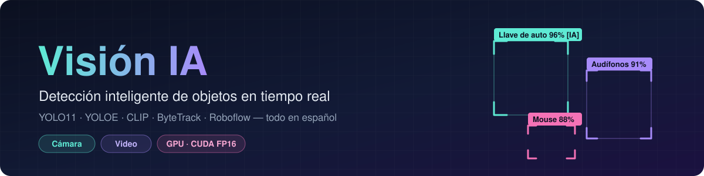
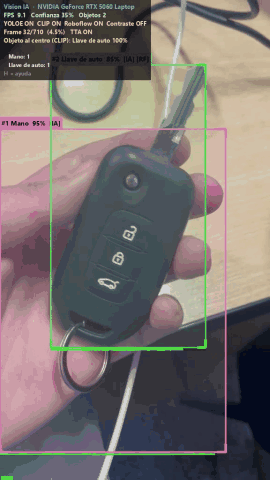
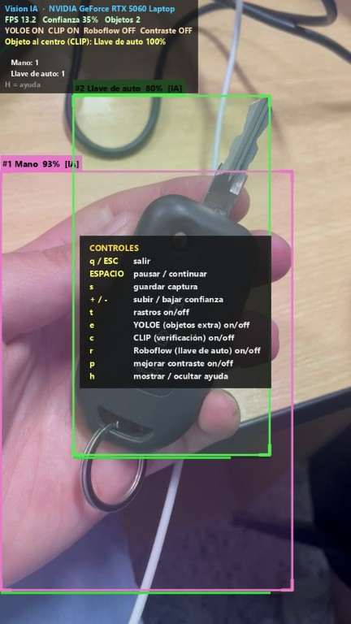
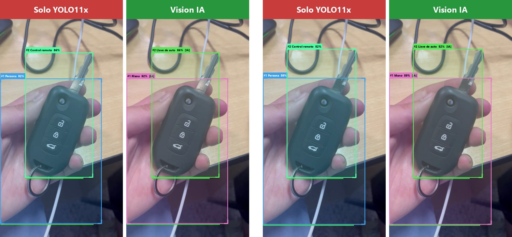

<p align="center">
  
</p>

<p align="center">
  
  
  
  
  
  
</p>

<p align="center">
  <b>Apunta la cámara a un objeto y la app te dice qué es, en español.</b><br>
  Celular, mouse, audífonos, llave de auto, cartera, lentes, control remoto, laptop… y más de 110 objetos.
</p>

<p align="center">
  <a href="#-demo">Demo</a> ·
  <a href="#-cómo-funciona">Cómo funciona</a> ·
  <a href="#-instalación">Instalación</a> ·
  <a href="#-uso">Uso</a> ·
  <a href="#-configuración">Configuración</a> ·
  <a href="#-dataset-roboflow">Dataset</a>
</p>

---

## 🎬 Demo

<table>
  <tr>
    <td align="center" width="50%">
      <br>
      <sub><b>Video procesado:</b> la llave se reconoce de frente, de lado y por detrás.</sub>
    </td>
    <td align="center" width="50%">
      <br>
      <sub><b>Interfaz:</b> panel de estado, conteo de objetos y ayuda (tecla <kbd>H</kbd>).</sub>
    </td>
  </tr>
</table>

### ¿Por qué no basta con YOLO?

YOLO se entrena con **COCO**, un dataset de 80 categorías. Ahí **no existen** “llave”, “audífonos”,
“cartera” ni “lentes”, así que un detector solo los confunde con lo más parecido que conoce:

<p align="center">
  
</p>

| | Solo YOLO11x | **Visión IA** |
|---|---|---|
| Llave de auto | ❌ “Control remoto” | ✅ **Llave de auto** [IA] [RF] |
| Mano sosteniendo algo | ❌ “Persona” | ✅ **Mano** [IA] |
| Audífonos | ❌ No los detecta | ✅ **Audífonos** |
| Calculadora | ❌ “Celular” | ✅ **Calculadora** |
| Etiquetas entre frames | Parpadean | Estables (votación temporal) |

> **[IA]** = etiqueta confirmada por CLIP · **[RF]** = confirmada por el modelo propio entrenado en Roboflow

---

## ✨ Características

- 🎯 **Más de 110 objetos en español**: las 80 clases COCO, más objetos cotidianos que COCO no tiene.
- 🧠 **Doble verificación con CLIP**: cada objeto “confuso” se revisa con un modelo de visión y lenguaje.
- 🔍 **Búsqueda de escena**: encuentra objetos que ningún detector vio (por ejemplo, audífonos).
- 🔑 **Modelo propio de Roboflow**: entrenado con imágenes de la llave de este proyecto.
- 🧷 **Seguimiento con ID**: cada objeto conserva su número (#1, #2…) mientras está en cámara.
- 🛡️ **Filtro de falsas alarmas**: descarta cajas que en realidad son piso, mesa, sombra o cables.
- ⚡ **Tiempo real en GPU**: ~14 FPS con todos los módulos en una RTX 5060 Laptop.
- 🎥 **Modo video**: procesa un archivo con máxima precisión (TTA) y guarda el resultado anotado.
- 🔤 **Texto con acentos y ñ** (OpenCV no los soporta de forma nativa).

---

## 🧠 Cómo funciona

Cada frame pasa por un *pipeline* de seis etapas. Ningún modelo decide solo: todos **votan**.

```mermaid
flowchart LR
    A[📷 Frame<br/>cámara o video] --> B[YOLO11x<br/>80 clases COCO]
    A --> C[YOLOE<br/>objetos extra por texto]
    B --> D{Fusión<br/>de cajas}
    C --> D
    D --> E[ByteTrack<br/>ID por objeto]
    E --> F[CLIP ViT-L/14<br/>verifica el recorte]
    A -.cada ~0.35 s.-> G[☁️ Roboflow<br/>llave-auto/1]
    D -.cajas descartadas.-> H[CLIP<br/>búsqueda de escena]
    F --> I[🗳️ Votación<br/>temporal]
    G --> I
    I --> J[🖼️ Etiqueta final<br/>en español]
    H --> J
```

| # | Etapa | Qué aporta |
|:-:|---|---|
| 1 | **YOLO11x** | Cajas precisas para las 80 clases COCO (persona, celular, mouse, laptop, taza…). |
| 2 | **YOLOE** | Detector de *vocabulario abierto*: se le da texto (`"headphones"`, `"car key"`, `"wallet"`) y busca esos objetos. Si su caja coincide con una de YOLO11, cuenta como voto extra. |
| 3 | **ByteTrack** | Asigna un ID estable a cada objeto para acumular evidencia entre frames. |
| 4 | **CLIP** | Mira el recorte de cada objeto y elige dentro de su **familia de confusión** (llave / celular / control / mouse / audífonos…). Si ve sobre todo “mesa”, “piso” o “cables”, marca la caja como falsa alarma. |
| 5 | **Roboflow** | Modelo propio `llave-auto/1`, consultado en segundo plano. Suma votos a “Llave de auto”. |
| 6 | **Votación** | Cada objeto acumula votos con media móvil. La etiqueta solo cambia si la nueva supera a la actual por más de un 15 %, así no parpadea. |

<details>
<summary><b>📐 Detalle de la votación</b></summary>

<br>

Para cada objeto rastreado y cada etiqueta candidata *e*:

```
puntaje(e) = votos_detector(e)  +  1.5 · votos_CLIP(e)  +  1.0 · votos_Roboflow(e)
```

- `votos_detector`: media móvil (α = 0.3) de la confianza de YOLO11 y YOLOE.
- `votos_CLIP`: probabilidad que CLIP asigna a *e* frente al resto de su familia y a los distractores.
- `votos_Roboflow`: solo para “Llave de auto”.

Ejemplo real con la llave del video:

| Etiqueta | Detector | CLIP | Puntaje |
|---|:-:|:-:|:-:|
| Control remoto | 0.79 | 0.00 | 0.79 |
| Celular | 0.40 | 0.00 | 0.40 |
| **Llave de auto** | 0.00 | 1.00 | **1.50** ✅ |

</details>

<details>
<summary><b>🔍 Búsqueda de escena (para objetos que nadie detecta)</b></summary>

<br>

Algunos objetos, como los audífonos, casi nunca superan el umbral de ningún detector. Cada pocos frames,
CLIP revisa:

1. el **centro de la imagen**, que se muestra en el panel como “Objeto al centro”, y
2. las **cajas de baja confianza** que los detectores descartaron.

Si CLIP reconoce un objeto con ≥ 60 % de probabilidad, se dibuja con la marca [IA]. Antes se aplican
estos filtros: se descartan tiras delgadas (cables, bordes), cajas que tocan un objeto ya detectado y
objetos de una familia que ya está en pantalla.

</details>

---

## 📦 Objetos que reconoce

| Categoría | Ejemplos |
|---|---|
| 📱 Electrónica | Celular, Laptop, Tablet, Monitor, Televisión, Mouse, Teclado, Control remoto, Calculadora, Control de videojuego |
| 🎧 Audio | Audífonos, Audífonos inalámbricos, Bocina, Micrófono |
| 🔑 Personales | Llave de auto, Llaves, Cartera, Lentes, Reloj de pulsera, Tarjeta, Encendedor |
| 🔌 Accesorios | Cargador, Batería externa, Memoria USB, Cable |
| ✏️ Oficina | Bolígrafo, Lápiz, Plumón, Cuaderno, Libro, Tijeras, Engrapadora |
| 🥤 Recipientes | Botella, Taza, Vaso, Copa, Lata, Termo, Tazón |
| 🎒 Bolsos | Mochila, Bolso, Maleta, Caja, Bolsa |
| 🧍 Personas | Persona, Mano |
| 🐶 COCO | Animales, vehículos, comida, muebles… (las 80 clases, traducidas) |

Para agregar un objeto nuevo, edita [`vocabulario.py`](vocabulario.py): pon el texto en inglés en
`YOLOE_VOCAB` y, si se confunde con otros, agrégalo a un grupo de `GRUPOS_CLIP`.

---

## 🚀 Instalación

**Requisitos:** Windows 10/11, Python 3.11 y una GPU NVIDIA (recomendada).
Sin GPU funciona en modo ligero (`yolo11s`, sin YOLOE).

```bash
# 1. Clonar
git clone https://github.com/ErickEchea/Visi-n-Artificial-.git
cd Visi-n-Artificial-

# 2. PyTorch con CUDA (ajusta cu128 a tu versión de CUDA)
pip install torch torchvision --index-url https://download.pytorch.org/whl/cu128

# 3. Resto de dependencias
pip install -r requirements.txt
```

> Los pesos de los modelos (YOLO11x, YOLOE y CLIP; ~2 GB en total) **se descargan solos** la primera vez que ejecutas la app.

### 🔐 API key de Roboflow (opcional)

El modelo `llave-auto` necesita una API key de [Roboflow](https://app.roboflow.com/settings/api).
**Nunca la escribas en el código.** Usa una de estas dos opciones:

```powershell
# Opción A: variable de entorno
setx ROBOFLOW_API_KEY "tu_api_key"

# Opción B: archivo local (ya está en .gitignore)
echo tu_api_key > roboflow_key.txt
```

Sin API key la app funciona igual; solo se desactiva el voto de Roboflow.

---

## 🕹️ Uso

### Con doble clic (Windows)

| Archivo | Acción |
|---|---|
| `ejecutar.bat` | Menú: cámara, video, video rápido o debug de Roboflow |
| `CAMARA.bat` | Cámara en tiempo real |
| `VIDEO.bat` | Procesa un video. Puedes **arrastrar un video encima** del archivo |

### Desde la terminal

```bash
python detectar_camara.py                 # cámara 0
python detectar_camara.py --camara 1      # otra cámara (USB externa)

python detectar_video.py                  # primer video de la carpeta
python detectar_video.py mi_video.mp4     # un video específico
python detectar_video.py --sin-tta        # más rápido
python detectar_video.py --sin-ventana    # procesar sin mostrar ventana

python debug_modelo.py foto.jpg           # ver todas las predicciones de Roboflow
```

Los videos procesados se guardan en `resultados/` y las capturas en `capturas/`.

### ⌨️ Controles

| Tecla | Acción | | Tecla | Acción |
|:-:|---|---|:-:|---|
| <kbd>Q</kbd> / <kbd>Esc</kbd> | Salir | | <kbd>E</kbd> | YOLOE on/off |
| <kbd>S</kbd> | Guardar captura | | <kbd>C</kbd> | CLIP on/off |
| <kbd>+</kbd> / <kbd>-</kbd> | Subir / bajar confianza | | <kbd>R</kbd> | Roboflow on/off |
| <kbd>T</kbd> | Rastros de movimiento | | <kbd>P</kbd> | Mejorar contraste (poca luz) |
| <kbd>H</kbd> | Mostrar ayuda | | <kbd>Espacio</kbd> | Pausar (solo video) |

---

## ⚙️ Configuración

Todo se ajusta en [`config.py`](config.py), sin tocar la lógica:

| Parámetro | Valor | Descripción |
|---|:-:|---|
| `CONF_MOSTRAR` | `0.35` | Confianza mínima para mostrar un objeto (también con <kbd>+</kbd>/<kbd>-</kbd>) |
| `IMGSZ_CAMARA` | `640` | Resolución de entrada de YOLO en cámara (medido: mejor para objetos cercanos) |
| `IMGSZ_VIDEO` | `960` | Resolución en video |
| `TTA_VIDEO` | `True` | *Test-Time Augmentation* en video: más preciso y ~2× más lento |
| `CLIP_PESO` | `1.5` | Cuánto pesa CLIP frente al detector |
| `ESCENA_MIN_PROB` | `0.60` | Probabilidad mínima para la búsqueda de escena |
| `ROBOFLOW_CONF` | `40` | Confianza mínima (%) del modelo Roboflow |
| `USAR_YOLOE` / `USAR_CLIP` / `USAR_ROBOFLOW` | `True` | Activar o desactivar cada módulo |

---

## 📁 Estructura del proyecto

```
├── detectar_camara.py    # App de cámara (captura en un hilo aparte, sin retraso)
├── detectar_video.py     # App de video (guarda el resultado anotado)
├── vision_core.py        # Motor: detección, fusión, tracking, CLIP, Roboflow, votación y dibujo
├── vocabulario.py        # Nombres en español, objetos extra y grupos de confusión
├── config.py             # Todos los parámetros
├── debug_modelo.py       # Diagnóstico del modelo Roboflow
├── ejecutar.bat · CAMARA.bat · VIDEO.bat
├── data.yaml             # Configuración del dataset (YOLOv8)
├── train/ valid/ test/   # Dataset "llave-auto" exportado de Roboflow
└── docs/                 # Imágenes de este README
```

---

## 🏷️ Dataset Roboflow

El modelo propio `llave-auto/1` se entrenó en Roboflow con un dataset creado para este proyecto
a partir de frames de video de la llave.

| | |
|---|---|
| **Proyecto** | [universe.roboflow.com/erick-5hjsk/llave-auto](https://universe.roboflow.com/erick-5hjsk/llave-auto/dataset/1) |
| **Imágenes** | 50 (35 entrenamiento · 10 validación · 5 prueba) |
| **Clase** | `llave-auto` |
| **Formato** | YOLOv8 · 640×640 |
| **Licencia** | CC BY 4.0 |

---

## 📊 Rendimiento

Medido en una **NVIDIA RTX 5060 Laptop GPU** con todos los módulos activos:

| Modo | Resolución | FPS |
|---|:-:|:-:|
| Cámara (YOLO11x + YOLOE + CLIP + Roboflow) | 640 | **~14** |
| Video con TTA | 960 | ~8 |

---

## ⚠️ Limitaciones

- El modelo `llave-auto` se entrenó con solo 50 imágenes de **una** llave; con otras llaves depende más de CLIP y YOLOE.
- Vista de canto, la llave puede salir como “Celular” durante unos frames hasta que CLIP la corrige.
- CLIP ViT-L/14 ocupa ~1 GB de VRAM (FP16); en GPUs pequeñas conviene `USAR_CLIP = False`.
- Roboflow requiere internet; sin conexión se desactiva solo y la app continúa.

---

## 🙌 Créditos

- [Ultralytics](https://github.com/ultralytics/ultralytics): YOLO11, YOLOE y ByteTrack
- [OpenAI CLIP](https://github.com/openai/CLIP) vía [Hugging Face Transformers](https://huggingface.co/openai/clip-vit-large-patch14)
- [Roboflow](https://roboflow.com): anotación, entrenamiento y despliegue del modelo `llave-auto`

<p align="center"><sub>Hecho por <a href="https://github.com/ErickEchea">ErickEchea</a> · 7.º semestre · Base del Conocimiento</sub></p>
